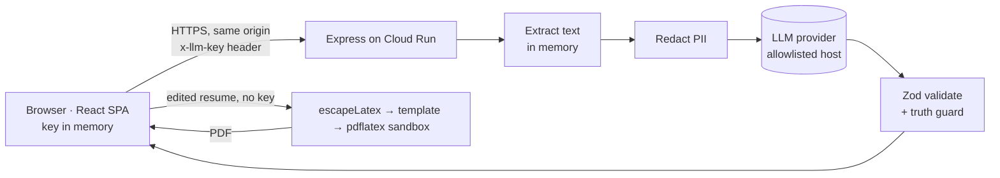

# Tailex

> Tailor your resume to a job **without inventing anything**.

Upload a resume (PDF/DOCX) and get a clean, one-page, ATS-friendly PDF from a typeset LaTeX template. Then paste a job description: Tailex shows which skills you're missing, adds only the ones **you confirm** you have, and suggests bullet rewrites you accept or reject one by one. A code-level truth guard blocks any suggestion that adds skills, tools, employers or numbers you never wrote.

**Live demo:** _coming soon_ · **Status:** Phase 0 (design docs). See [PROGRESS.md](docs/PROGRESS.md).

## Features
- PDF/DOCX upload → structured, editable resume data
- One-page LaTeX template → PDF, with page-overflow warning and "tighten spacing"
- **Bring your own key** (Gemini first). Your key, your quota
- **Contact details redacted** before anything reaches the LLM
- JD keyword match: matched, missing (required vs nice-to-have) and extra skills, with a score before/after
- Bullet rewrite suggestions as an accept/reject diff; fabrications are shown as **Blocked**
- **Sample mode:** try the whole flow without a key
- Light/dark mode, keyboard accessible, mobile friendly

## Architecture

More detail in [ARCHITECTURE.md](docs/ARCHITECTURE.md). Decisions and tradeoffs in [DECISIONS.md](docs/DECISIONS.md).

## Privacy
- **We store nothing.** No accounts, no database, no saved resumes. Uploads are processed in memory and never written to disk.
- *"Your resume text, with contact details removed, is sent to your chosen LLM provider."* Name, email, phone and links are replaced with placeholders **before** the LLM call and re-inserted only when rendering your PDF. Redaction is **best-effort**: review what's sent in the "See what's sent" panel.
- Some providers' free tiers may use prompts to improve their products. Check your provider's terms.
- Our app never logs request bodies, file contents or keys. Our hosting platform's request logs (Cloud Run) may record **IP address, user agent and timestamps**, but **never content or keys**.
- Analytics, if enabled, are counts only (e.g. "a PDF was generated"), never content.

## How the key is handled
1. You paste your own API key (free from Google AI Studio). It lives in **browser memory** only.
2. Optional **"Remember on this device"** (off by default) saves it to `localStorage`. **"Clear key"** removes it from both. No cookies.
3. One helper attaches it as the `x-llm-key` header (with `x-llm-provider`) over HTTPS. It is never put in a URL, query string or body.
4. Only three endpoints read it: `/api/parse`, `/api/tailor`, `/api/key/test`.
5. The server maps the provider **name** to a hardcoded host (no client-supplied URLs), makes one call, and discards the key. It is never stored, logged, or included in errors.

Threat model: [SECURITY.md](docs/SECURITY.md).

## Tech stack
React 19 · Vite · TypeScript (strict) · Tailwind v4 · shadcn/ui (Radix) · Node 24 · Express · Zod · pdflatex (TeX Live) · Vitest · supertest · Playwright · Docker · GitHub Actions · Google Cloud Run

## Development
_Set up in Phase 1._ Prerequisites: Node 24, Docker Desktop (for pdflatex).
```bash
npm install
npm run dev
```

## Docs
[SPEC](docs/SPEC.md) · [ARCHITECTURE](docs/ARCHITECTURE.md) · [DECISIONS](docs/DECISIONS.md) · [SECURITY](docs/SECURITY.md) · [TESTING](docs/TESTING.md) · [PROGRESS](docs/PROGRESS.md)

## License
[MIT](LICENSE)
