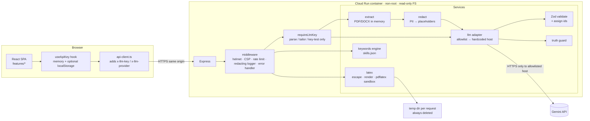
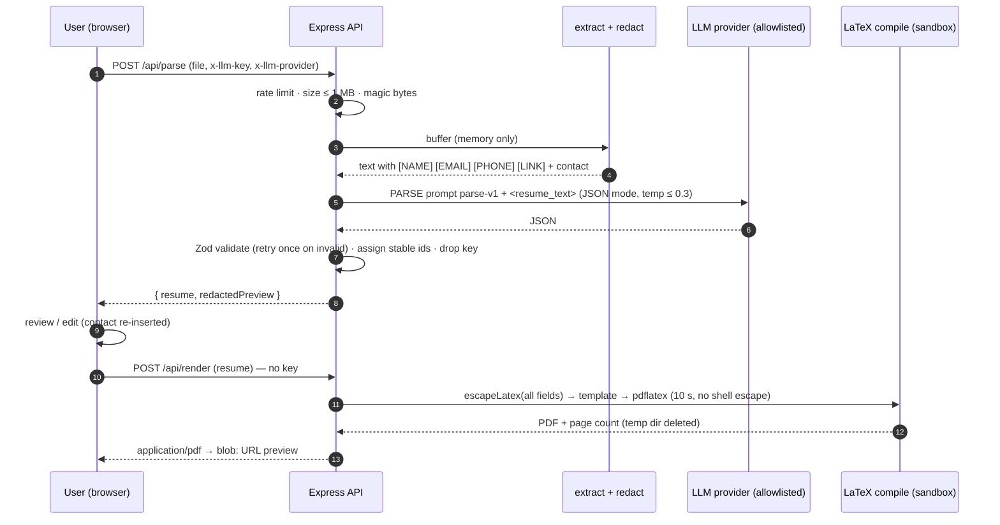
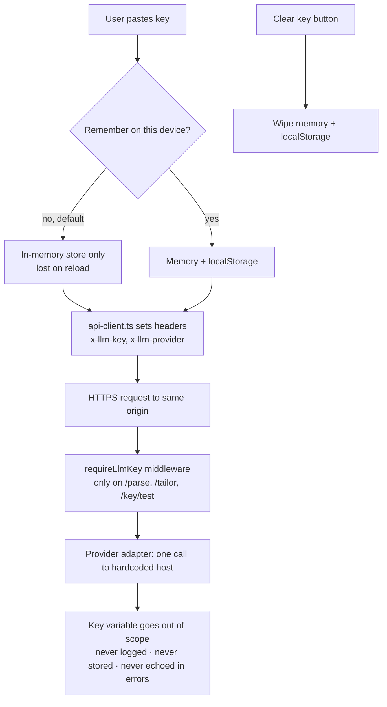

# ARCHITECTURE — Tailex

## 1. Big picture

One container on Cloud Run runs an Express server that serves **both** the built React SPA (static files) and the `/api/*` routes. Same origin means no CORS configuration and a simpler CSP.



## 2. Parse → render flow



## 3. Key lifecycle



## 4. Module layout (created in Phase 1)

```
cvfit/
├─ apps/
│  ├─ web/                      # Vite + React SPA
│  │  └─ src/
│  │     ├─ app/                # router, layout, stepper, theme
│  │     ├─ features/
│  │     │  ├─ api-key/         # KeyCard, useApiKey (hand-written)
│  │     │  ├─ upload/
│  │     │  ├─ review/
│  │     │  ├─ preview/
│  │     │  └─ tailor/          # keyword chips, diff list
│  │     ├─ components/ui/      # shadcn primitives
│  │     └─ lib/api-client.ts   # the ONLY place headers are attached
│  └─ server/                   # Express API + static hosting
│     └─ src/
│        ├─ routes/             # thin: validate input → call service → respond
│        ├─ middleware/         # rateLimit, requireLlmKey, logger, errors, security headers
│        ├─ services/
│        │  ├─ extract/         # pdf + docx text, magic bytes
│        │  ├─ redact/          # PII → placeholders
│        │  ├─ llm/             # LlmProvider interface, providers/{gemini,mock}, allowlist
│        │  ├─ latex/           # escapeLatex (hand-written), template, compile sandbox, log parser
│        │  ├─ keywords/        # engine + skills.json
│        │  └─ truth-guard/     # hand-written
│        └─ prompts/            # parse.ts (parse-v1), tailor.ts (tailor-v1)
└─ packages/
   └─ shared/                   # Zod schemas + inferred types + error codes
```

**Rule of thumb:** routes are thin, services are pure where possible (easy to unit test), and side effects (network, child processes) sit behind small interfaces that tests can swap for fakes.

## 5. Provider adapter

```ts
interface LlmProvider {
  readonly name: ProviderName; // "gemini" | "mock"
  generateJson(input: {
    apiKey: string;
    system: string;
    user: string;
    temperature: number;
    timeoutMs: number;
  }): Promise<unknown>; // raw JSON; the caller validates with Zod
}
```

- `getProvider(name)` looks up a **hardcoded** map. Hosts are constants in code. There is no code path that builds a URL from client input.
- Timeouts via `AbortController`, limited retries on network/5xx only.
- The `mock` provider returns fixtures (valid and malformed). It is enabled only when `NODE_ENV !== "production"` or in sample mode.

## 6. Trust boundaries

| Boundary       | Untrusted input                        | Control                                                                          |
| -------------- | -------------------------------------- | -------------------------------------------------------------------------------- |
| Browser → API  | files, JSON bodies, headers            | size limits, magic bytes, Zod, rate limit, allowlist                             |
| API → LLM      | resume/JD text (may contain injection) | PII redaction, data tags, JSON mode                                              |
| LLM → API      | model output                           | Zod validation, retry once, truth guard                                          |
| API → pdflatex | user strings                           | `escapeLatex`, no shell escape, `openin/openout_any=p`, timeout, concurrency cap |
| API → browser  | everything rendered                    | React text rendering only, no `dangerouslySetInnerHTML`, strict CSP              |

## 7. Deployment (Phase 6)

Multi-stage Dockerfile: build web + server → runtime image with Node 24 + minimal TeX Live, non-root user, read-only root FS except the temp dir, healthcheck on `/api/health`. Cloud Run: min instances 0, max 1–2, **low concurrency**, CPU/memory limits, `trust proxy` set to Cloud Run's single hop.
